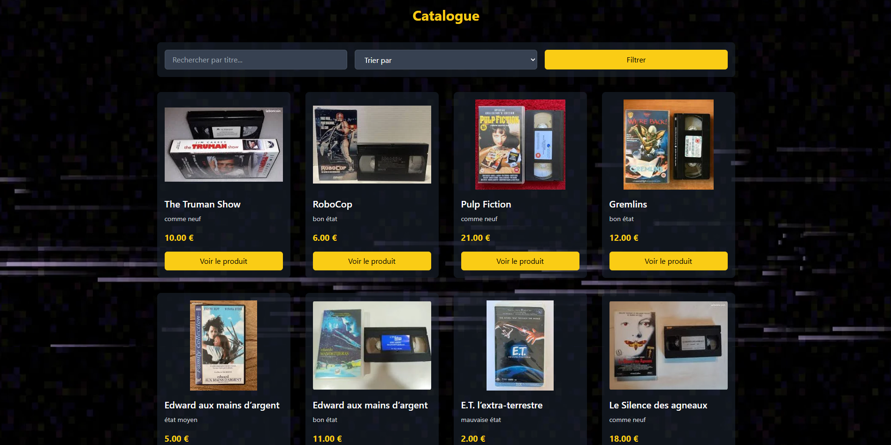

# Back to the VHS

[](https://github.com/thomasgitprojet/backToTheVHS-v2/actions/workflows/ci.yml)

**Back to the VHS** is a marketplace where movie lovers buy and sell second-hand VHS tapes.
Users create an account, publish listings with a photo, browse the catalogue and fill their cart.

🌐 **Live site:** [backtothevhs.com](https://backtothevhs.com)



> This is my first Symfony project. I built it during my web developer training, then used it as a playground to deepen my Symfony skills: security, services, code quality and continuous integration.

---

## Features

- **Catalogue** with search, sorting (price, title, publication date) and pagination
- **User accounts**: registration (protected by Google reCAPTCHA), AJAX login, profile page and profile editing
- **Listings**: users publish, edit and delete their own VHS tapes, with a photo (JPEG/PNG, 2 MB max)
- **Movie autocomplete**: while typing a title, suggestions come from the database (see the diagram below)
- **Cart**: add and remove items, checkout (demo flow, no payment)
- **Contact form** that sends an email to the site owner
- **Admin area**: user management and listing moderation
- **Custom console command** `app:add-movies` to add movies to the database

## Tech stack

| Layer | Technologies |
|---|---|
| Back end | PHP 8.3, **Symfony 7.4 LTS**, Doctrine ORM 3, Doctrine Migrations |
| Front end | Twig, Tailwind CSS, JavaScript, Webpack Encore |
| Database | MySQL 8.4 |
| Environment | Docker, FrankenPHP (worker mode), Caddy — based on [symfony-docker](https://github.com/dunglas/symfony-docker) |
| Quality | PHPStan (level 6, with Doctrine and Symfony extensions), GitHub Actions |
| Other | Monolog, KnpPaginator, Symfony Mailer, Google reCAPTCHA v2 |

## What I implemented

- **Authorization with a Voter**: `ProductVoter` decides who may edit or delete a listing. Controllers only ask `denyAccessUnlessGranted(ProductVoter::EDIT, $product)`, so the rule lives in one place.
- **Services and dependency injection**: `ImageManager` handles every image file (upload and deletion). It receives its upload directory with `#[Autowire]` and the Symfony `Filesystem` service.
- **Safe image handling**: data is validated before any file is written; the product and its publication are saved in a single transaction; if saving fails, the uploaded file is removed; when an image is replaced, the old one is deleted only once the new one is saved.
- **Form validation**: unique email and username (`UniqueEntity`), image required on creation only (custom form option).
- **Logging**: Monolog writes daily log files in production (`fingers_crossed` handler, 14-day rotation).
- **Code quality**: PHPStan level 6 and `composer audit` run on every push.
- **Continuous integration**: GitHub Actions builds the Docker images, starts the stack, checks that the site responds, audits the dependencies and runs PHPStan.

## Security

The three most common web attacks, and how this project prevents them:

### 1. SQL injection
**Attack:** inserting SQL code into a form field to manipulate the database, e.g. `' OR 1=1 --`.
**Protection:** every query goes through Doctrine with bound parameters (`setParameter()`); user input is never concatenated into SQL.

### 2. Cross-Site Scripting (XSS)
**Attack:** injecting JavaScript into a page to steal data such as session cookies, e.g. `<script>alert('XSS')</script>`.
**Protection:** Twig escapes every variable displayed with `{{ }}`; the `|raw` filter is never used on user input.

### 3. Cross-Site Request Forgery (CSRF)
**Attack:** making a logged-in user perform an action without knowing it, through a form hidden on another website.
**Protection:** CSRF tokens on the login form (`enable_csrf: true`) and on every Symfony form; sensitive actions such as deleting a listing only accept `POST` requests and check a CSRF token.

### Also in this project
- **Access control**: a `ProductVoter` makes sure only the owner can edit or delete a listing (HTTP 403 otherwise); the admin area requires `ROLE_ADMIN`.
- **Open redirect fixed**: after login, the `redirect` parameter is accepted only if it is an internal path (`/...`), never an external URL such as `//evil.com`.
- **File uploads**: the file type is detected from its content, size is limited, and files get a random name.
- **Secrets**: real credentials live in `.env.local` files that are never committed.

## How the movie autocomplete works

```
+--------------------+
| User types a title |
+--------------------+
          |
          v
+----------------------+
| movieTitle (input)   |
+----------------------+
          |
          v
[ JS → AJAX GET /movies/autocomplete?term=Ince ]
          |
          v
+------------------------------+
| Symfony controller           |
| - MoviesRepository           |
| - returns JSON [{id, title}] |
+------------------------------+
          |
          v
+---------------------------+
| Suggestion list (HTML)    |
| on click, fills:          |
|  - movieTitle             |
|  - movieId (hidden field) |
+---------------------------+
          |
          v
[ Form submitted ]
          |
          v
+--------------------------+
| Symfony controller       |
| - reads movieId          |
| - setMovie(find($id))    |
| - persist + flush        |
+--------------------------+
```

## Local installation

**Requirements:** [Docker Compose](https://docs.docker.com/compose/install/) v2.10+ and Git.

```bash
# 1. Get the code
git clone https://github.com/thomasgitprojet/backToTheVHS-v2.git
cd backToTheVHS-v2

# 2. Create your environment file, then edit the values (passwords, keys...)
cp .env.example .env

# 3. Build and start the containers
#    (Composer dependencies and database migrations are installed automatically)
docker compose build --pull
docker compose up -d --wait

# 4. Build the front-end assets
docker compose exec php npm install
docker compose exec php npm run dev

# 5. (Optional) Add movies to the database
docker compose exec php bin/console app:add-movies
```

Then open **https://localhost** and accept the self-signed certificate.

To stop the containers: `docker compose down` (your data is kept in a Docker volume).

## Development notes

All `php`, `composer` and `bin/console` commands run **inside the container**: `docker compose exec php ...`

**Debugging**
- `dump($variable)` shows a variable in the web debug toolbar (target icon) without breaking the page.
- `dd($variable)` (*dump and die*) shows the variable and stops the script.
- In Twig: `{{ dump(variable) }}`.
- Remove them before committing.

**Logs**
- The `var/` folder only exists inside the container. Read the logs with:
  `docker compose exec php tail -n 20 var/log/dev.log` (or `tail -f` to follow them live).

**When a change is not taken into account** (FrankenPHP worker mode keeps the app in memory):
```bash
docker compose exec php bin/console cache:clear
docker compose restart php
```

**Emails in development** are caught by Mailpit (nothing is really sent). Find its web interface with `docker compose port mailer 8025`.

**Code quality**
```bash
docker compose exec php vendor/bin/phpstan analyse --memory-limit=1G
docker compose exec php composer audit
```

**Useful MakerBundle commands**
```bash
docker compose exec php bin/console make:controller
docker compose exec php bin/console make:entity
docker compose exec php bin/console make:migration
docker compose exec php bin/console make:form
docker compose exec php bin/console make:voter
```

## Deployment (Hostinger shared hosting)

The production site runs on a Hostinger shared hosting plan (PHP 8.3, MariaDB 11.8), deployed over SSH.

**Server specifics**
- The web root is `public_html/`. A symbolic link `public -> public_html` lets Symfony keep using `public/` (Webpack Encore, assets, uploads). Do not delete it.
- The default PHP on the command line is 8.0: `~/.bash_profile` loads `~/.bashrc`, which puts PHP 8.3 first in the `PATH` (`/opt/alt/php83/usr/bin`).
- Production settings live in `.env.local` on the server (never committed). For MariaDB, `DATABASE_URL` must use `serverVersion=mariadb-11.8.9`: with a MySQL version, Doctrine Migrations reports a false "metadata storage is not up to date" error.
- `public_html/uploads/` holds the users' images: never overwrite or delete it during a deployment.


**Deploying a new version**
```bash
# On the local machine
docker compose exec php npm run build
git archive --format=tar.gz -o deploy-code.tar.gz HEAD bin config migrations src templates translations composer.json composer.lock symfony.lock
# Upload the archive to the site folder (next to public_html), then over SSH:
tar -xzf deploy-code.tar.gz
composer install --no-dev --optimize-autoloader --no-interaction   # the final "assets:install public [KO]" is harmless
php bin/console doctrine:migrations:migrate --no-interaction
php bin/console cache:clear
```
Copy the new `public/build/` folder into `public_html/build/` (keep `public_html/uploads/`).
Logs: `var/log/prod-YYYY-MM-DD.log` (errors only, kept 14 days).


> ⚠️ `doctrine:fixtures:load` **empties the whole database** before loading test data.

## Author

**Thomas Desse** — junior web developer (French vocational certification *Développeur Web et Web Mobile*)

- Portfolio: [thdesse-portfolio.com](https://thdesse-portfolio.com)
- GitHub: [@thomasgitprojet](https://github.com/thomasgitprojet)
